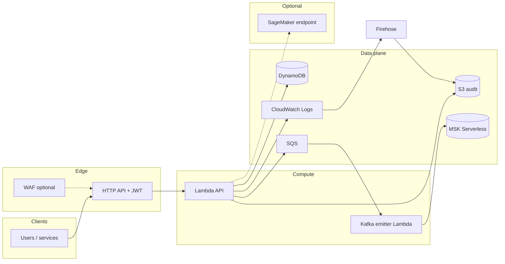

# Machine-Level AI Threat Detection System (ML-AITDS)

Defensive API security and monitoring prototype: real-time scoring, layered authority, adaptive thresholds, and streaming audit events—aligned with the product principles in **§ Product requirements** below.

---

## 1. Implementation checklist (what exists in this repo)

### Infrastructure (AWS CDK, TypeScript — `infra/`)

| Area | Delivered |
|------|-----------|
| **AuthStack** | Cognito User Pool + public app client (JWT for HTTP API). |
| **StateStack** | DynamoDB: `mlaitds-authority-state`, `mlaitds-abuse-budget`, `mlaitds-authority-velocity`, `mlaitds-request-log-index`. |
| **TelemetryStack** | CloudWatch log group for HTTP API access logs; S3 audit bucket; subscription → Kinesis Data Firehose → S3. |
| **StreamingStack** | VPC (2 AZ + NAT); Amazon MSK Serverless; SQS `mlaitds-security-events`; Lambda **kafka-emitter** (KafkaJS + MSK IAM). |
| **ApiStack** | HTTP API + Cognito JWT authorizer; Lambda **api** handler; routes `GET /hello`, `POST /feedback`; access logging to Telemetry. |

### Application logic (`infra/lambdas/api/index.ts`)

| Capability | Delivered |
|------------|-----------|
| **Traffic / identity context** | `sub` from JWT; `sourceIp`; route/method; structured audit payload (not raw payload bodies). |
| **Point anomaly signals** | Adaptive frequency / fast-timing / repeat-route thresholds (from `ADAPTIVE_TUNING`). |
| **Sequence modeling** | Rolling `routeSequence` (16); churn, two-cycle, distinct burst, entropy, repeated bigram. |
| **Cross-session intelligence** | `CROSS_SESSION`: EWMA risk, totals, distinct days, recent IPs; spike / IP-change boosts. |
| **Optional ML** | SageMaker Runtime invoke when `-c mlAnomalyEndpoint=...`; feature vector includes tuning + sequence context. |
| **Risk composition** | `risk_base` → `risk_cross` → optional ML blend → final `risk_score`. |
| **Authority & constraint** | `allow` / `throttle` (delay) / `flag`; adaptive **decision** cutoffs from biases; daily **abuse budget** tightens decisions. |
| **Authority velocity** | Delta level / per-minute estimate in `authority_velocity`. |
| **Adaptive learning** | `ADAPTIVE_TUNING`: EWMAs, leniency/strictness biases, implicit evolution each request. |
| **Feedback loop** | `POST /feedback` with `false_alarm`, `confirmed_threat`, `benign_override`. |
| **Persistence** | DynamoDB items (see ERD); S3 `api-decisions/…`; optional SQS → Kafka; Lambda `MLAITDS_AUDIT` JSON logs. |

### Not in repo (yet)

- Admin UI (dashboards, overrides, graphs).
- WAF / edge integration in CDK (discussed in design chat only).
- Trained SageMaker model artifact (only the **invoke hook** exists).
- Automated tests, runbooks, multi-tenant isolation hardening.

---

## 2. Alignment with the initial README

The original specification was a **product/architecture brief**; this repository is a **working vertical slice** of that spec. Summary:

| README theme | In code? | Notes |
|--------------|----------|--------|
| Multi-layer authority (no single “AI brain”) | **Partial** | Heuristic + optional SageMaker **inform** risk; **rules + budgets + delays** enforce allow/throttle/flag. No separate microservices per layer—layers are **logical** in one Lambda. |
| Intelligence without direct execution | **Yes** | ML/scores do not bypass Dynamo-backed authority; no irreversible “block account” action in v1. |
| Interpretation / intent / harm typing | **Partial** | Signals proxy “intent” (sequence, cross-session); no explicit financial/physical/reputational classifiers. |
| Authority & constraint: progressive authority, impact budget, friction | **Partial** | **Abuse budget**, **throttle delay**, **authority level** (0–3) + velocity; **adaptive** cutoffs. Cooldowns are implicit via EWMA/bias decay, not a dedicated cooldown clock. |
| Execution & monitoring: logging, audit, reversibility | **Partial** | Strong **audit trail** (Dynamo + S3 + logs + Kafka path). **Reversibility** is “soft” (no hard block—mostly friction + flag). |
| Assumption-abuse threat model (not STRIDE/CVSS) | **Design intent** | Implemented as **behavioral** heuristics, not a separate threat-model doc in repo. |
| Traffic monitoring fields (IP, headers, …) | **Partial** | IP + JWT claims + route in app; **API Gateway access logs** carry broader context; **payload shape** not explicitly hashed in access log (could add). |
| Detection: adaptive rate, sequence, long horizon, cross-endpoint | **Partial** | Adaptive **per-minute** load + **sequence** + **cross-session** + **Kafka** for downstream analytics. |
| Abuse / impact budget | **Yes** | Daily spend vs cap; escalates friction. |
| Invariants (AI alone never irreversible, etc.) | **Partial** | Matches **prototype** scope; production needs explicit policy service + human gates for high impact. |
| **Admin dashboard** | **No** | Requirements only; not implemented. |

**Deliberate simplifications vs README:** single Lambda bundles “intelligence + interpretation + authority” for speed of iteration; MSK/SageMaker are **optional integration points** rather than full ML-ops; no offensive content per README.

---

## 3. How to use effectively — and advice

### Deploy

```bash
cd infra
npm install
npx cdk bootstrap aws://ACCOUNT/REGION   # once
npx cdk deploy --all
# Optional SageMaker hook:
npx cdk deploy --all -c mlAnomalyEndpoint=your-endpoint-name
```

Set `CDK_DEFAULT_ACCOUNT` / `CDK_DEFAULT_REGION` (or `--profile`) as usual.

### Call the API

1. Create a Cognito user and obtain an **access token** (Hosted UI or CLI).
2. `GET <HttpApiUrl>/hello` with `Authorization: Bearer <token>`.
3. Inspect JSON body / headers / Dynamo / S3 `api-decisions/<date>/<requestId>.json`.
4. Optional: `POST <HttpApiUrl>/feedback` with body  
   `{"verdict":"false_alarm"|"confirmed_threat"|"benign_override","requestId":"..."}`.

### Use Kafka path

After deploy, confirm **SQS** drains and **MSK** topic `mlaitds.security.events` receives JSON audit messages (consumer of your choice). Bootstrap brokers are resolved inside the emitter via `kafka:GetBootstrapBrokers`.

### Advice

1. **Tighten IAM** on MSK / `kafka-cluster:*` patterns before production; scope to cluster UUID ARNs when stable.
2. **Retrain or disable** SageMaker if you change `buildMlFeatures` dimensions (they have changed as features were added).
3. **Add WAF** in front of HTTP API for volumetric abuse; keep app logic for slow/low-noise abuse.
4. **Build the admin dashboard** next: read `authority_state`, `request_log_index`, and S3 audits; add **manual override** that writes a known Dynamo key consumed by the API.
5. **Tune constants** (`FREQ_THRESHOLD`, boosts, EWMA α) using your traffic distributions; log **false positive** rate when using `/feedback`.
6. **Cost:** MSK Serverless + NAT is meaningful; use a **feature flag** or separate stack for dev if you only need Dynamo + API.
7. **Physical / financial harm:** add **human-in-the-loop** and hard caps outside this Lambda before any real-world high-stakes automation.

---

## 4. Architecture sketch (components)



---

## 5. ERD sketch (logical entities → DynamoDB keys)

Physical tables: **`authority_state`** (wide row per principal, many `sk`), **`abuse_budget`**, **`authority_velocity`**, **`request_log_index`**.

```mermaid
erDiagram
  PRINCIPAL ||--o{ REQUEST_LOG_INDEX : "requestId + ts"
  PRINCIPAL ||--|| AUTHORITY_PROFILE : "sk AUTHORITY_PROFILE"
  PRINCIPAL ||--|| LATEST_RISK : "sk LATEST_RISK"
  PRINCIPAL ||--|| CROSS_SESSION : "sk CROSS_SESSION"
  PRINCIPAL ||--|| ADAPTIVE_TUNING : "sk ADAPTIVE_TUNING"
  PRINCIPAL ||--|| HELLO_LAST : "sk HELLO_LAST"
  PRINCIPAL ||--|| AUTHORITY_VELOCITY : "principalKey"
  PRINCIPAL ||--o{ ABUSE_BUDGET_WINDOW : "windowId day"

  PRINCIPAL {
    string cognito_sub PK
  }

  AUTHORITY_STATE_ROW {
    string pk "SUB#sub"
    string sk "LATEST_RISK | AUTHORITY_PROFILE | ..."
  }

  REQUEST_LOG_INDEX {
    string requestId PK
    string ts SK
  }

  ABUSE_BUDGET_WINDOW {
    string principalKey PK
    string windowId SK
  }

  AUTHORITY_VELOCITY {
    string principalKey PK
  }
```

**Key patterns**

- **`authority_state`:** `pk = SUB#<cognito_sub>`, `sk` ∈ `AUTHORITY_PROFILE`, `LATEST_RISK`, `CROSS_SESSION`, `ADAPTIVE_TUNING`, `HELLO_LAST`, …
- **`abuse_budget`:** `principalKey`, `windowId` (e.g. `YYYY-MM-DD`).
- **`authority_velocity`:** `principalKey` (same as `sub`).
- **`request_log_index`:** `requestId`, `ts`.

---

## 6. Repository layout

```
README.md              ← this file (spec + implementation guide; Mermaid on GitHub)
infra/
  bin/ml-aitds.ts      ← CDK app entry
  lib/
    auth-stack.ts
    state-stack.ts
    telemetry-stack.ts
    streaming-stack.ts
    api-stack.ts
  lambdas/
    api/index.ts       ← /hello + /feedback + scoring + authority
    kafka-emitter/index.ts
  package.json
  cdk.json
  tsconfig.json
```

---

## 7. Product requirements (source specification)

The following is preserved from the original project brief: defensive posture, multi-layer authority model, non-traditional threat framing, required API monitoring capabilities, abuse-budget concept, invariants, dashboard expectations, and exclusions (no attack steps, exploits, or offensive tooling).

<details>
<summary><strong>Expand: original README specification</strong></summary>

Machine‑Level AI Threat Detection System (ML‑AITDS)

**Role & perspective:** Design a next-generation AI‑core API Security & Monitoring Tool from a defender’s view; reason about machine-speed adversaries only to improve failure modes—not to enable attacks.

**Product goal:** Real-time API monitoring; intelligent, low-noise, long-horizon abuse detection; resilience to AI-driven misuse; protection of **decision integrity**, not only endpoints; resilience to financial, reputational, physical, and informational harm.

**AI assumptions:** Protected AI can decide, generate, automate, and advise (high impact). **No single AI output may directly cause irreversible harm without layered validation.**

**Required architecture (multi-layer, not one brain):**

1. **Intelligence** — insights/predictions; confidence/uncertainty; **no direct execution**.
2. **Interpretation & intent** — semantic meaning, harm type, ambiguity/strategic probing.
3. **Authority & constraint** — what is allowed now; progressive authority; impact budgets; cooldowns; friction scaling; **authority grows slower than confidence**.
4. **Execution & monitoring** — safe execution; logging; reversibility; audit; assume failure; contain blast radius.

**Threat modeling:** Prefer **assumption abuse** over STRIDE/CVSS/signatures alone. Per feature: list assumptions (identity, behavior, time, semantics, trust) and abuse scenarios (legitimate actions → sequenced/delayed → harmful “reasonable” outcomes).

**API capabilities required:** Real-time ingestion; logging IP, headers, timestamps, endpoint, method, token/identity metadata, **payload shape** (not raw sensitive data). Detection: **adaptive risk-based** limits, **sequence** awareness, **long horizon**, **cross-endpoint** correlation; patterns including brute force, slow probing, perfect timing, machine-like efficiency, semantic boundary testing. **Structured JSON** logs; capture **why**, not only **what**.

**Abuse / impact budget:** Per identity, invisible allowance; efficient/precise spend suspicious; depletion → **friction**, not only hard block.

**Invariants (examples):** AI confidence alone never authorizes irreversible actions; ambiguity reduces authority; automation amplification capped; financial impact bounded vs human intervention; physical-harm outputs assistive not directive; no silent authority escalation; observability cannot be disabled by behavior.

**Admin dashboard (design target):** Real-time risk alerts; risk trends; request sequence views; authority growth; manual overrides; full audit; calm under pressure.

**Expected outputs:** Architecture, threat-model template, feature-to-abuse mapping, AI-resilient strategy, justifications; system should age gracefully and treat meaning, intent, and authority as first-class.

**Do not include:** Step-by-step attacks, exploit code, offensive tooling guidance.

**Core mindset:** Secure **assumptions, meaning, intent, time, and authority**—not APIs alone.

</details>

---

*ML-AITDS — defensive design only.*
